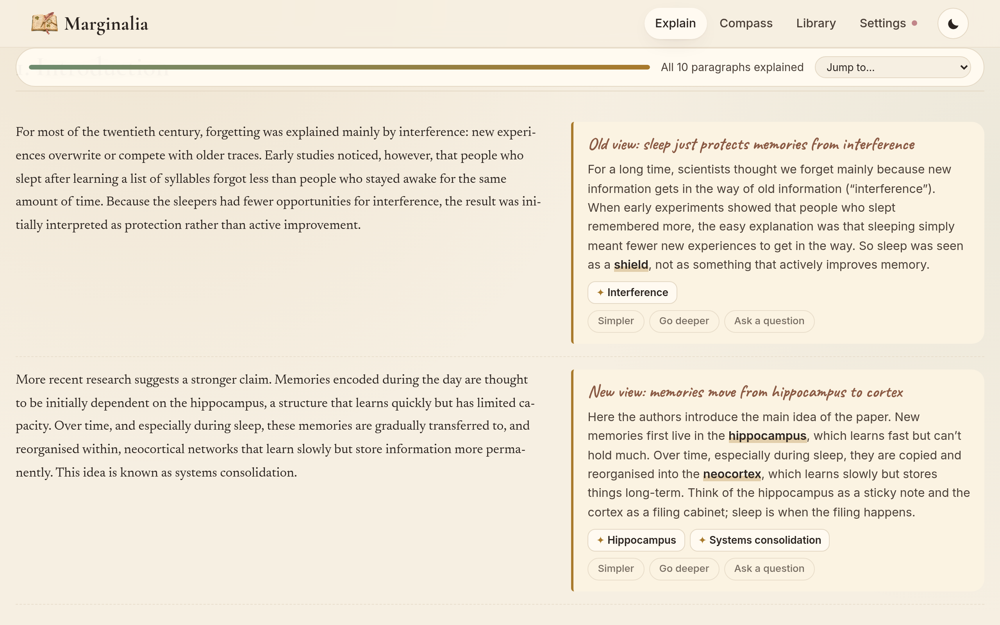
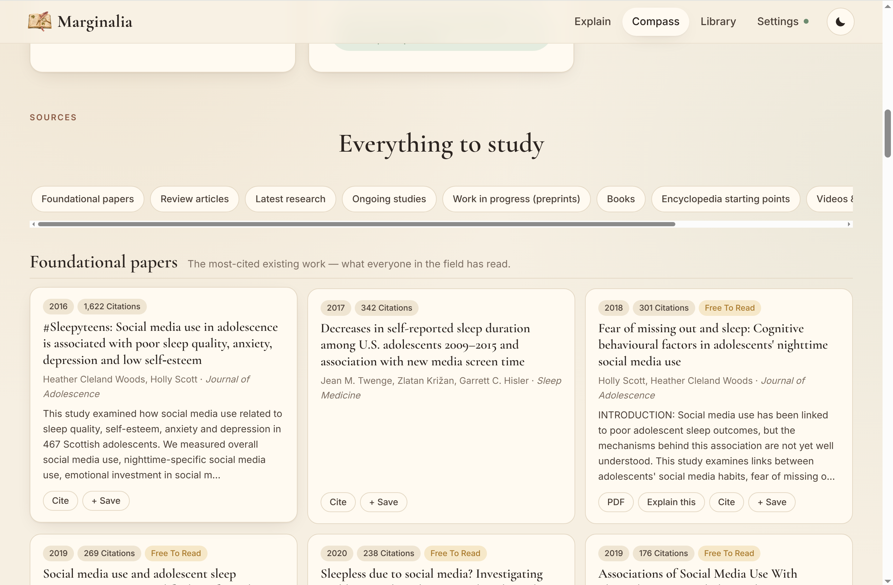
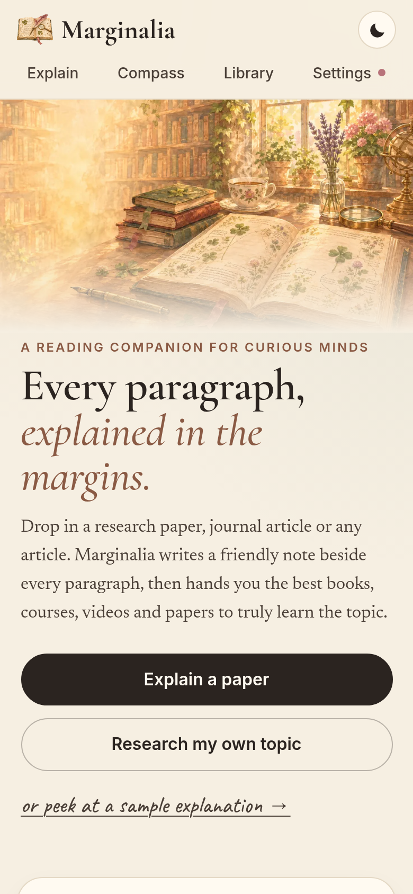
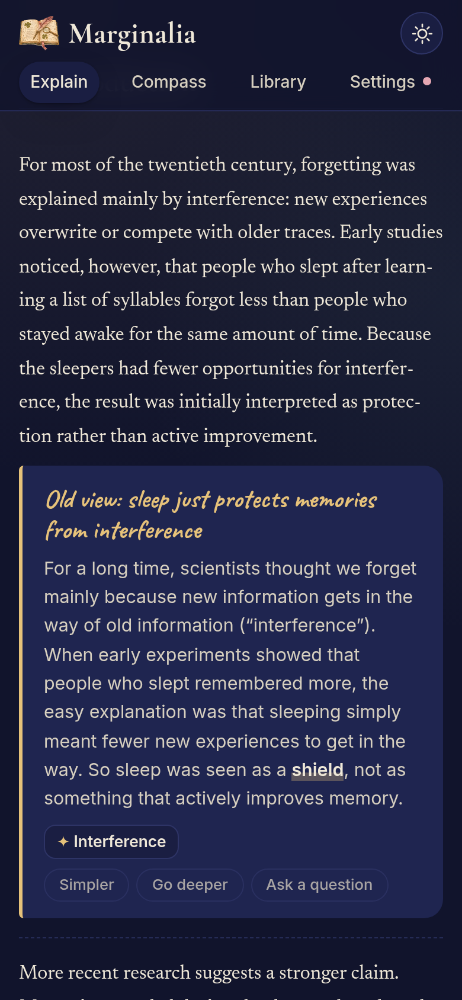

  

<h1 align="center">Marginalia</h1>

<em>Every paragraph, explained in the margins.</em>

  Hard paper? Drop it in and get a friendly note beside every paragraph, 
  then a big list of real books, courses, videos and papers to truly learn the topic.

  <a href="#-paper-explainer">Paper Explainer</a> &nbsp;·&nbsp;
  <a href="#-research-compass">Research Compass</a> &nbsp;·&nbsp;
  <a href="#-turn-on-the-ai-free">Free AI key</a> &nbsp;·&nbsp;
  <a href="#-questions">Questions</a> &nbsp;·&nbsp;
  <a href="#-contact">Contact</a>

---

## 🌿 What is Marginalia?

Marginalia is a reading companion for anyone who has ever stared at a research paper and thought *"what does this even mean?"*

It has two parts:

| | |
| --- | --- |
| 📖 **Paper Explainer** | Give it a paper or article. It explains **every paragraph** in plain words, right beside the original, and ends with a list of the best resources to learn more. |
| 🧭 **Research Compass** | Writing your own paper? Type your title. It finds **existing papers, ongoing studies, books, websites and videos**, and suggests research questions and an outline. |

Not sure yet? Click **"peek at a sample explanation"** on the home page to see a finished example. It works without any setup.

---

## 📖 Paper Explainer

### How to use it

1. Click **Explain** at the top.
2. Choose how to bring your reading:
   - **Upload a file**: PDF, Word (.docx), .txt or .md
   - **Paste a link**: an article, an arXiv link, a DOI (like `10.1371/journal.pone.0228162`) or a Wikipedia page
   - **Paste text**: copy the text from anywhere and paste it in
3. Pick your level:
   - **Simple**: explained like you're 14 and curious
   - **Student**: like a first-year university student
   - **Expert**: for someone from a neighbouring field
4. Press **Explain every paragraph**. Notes appear one section at a time. You can start reading straight away.

### What you get

- **The big picture** at the top: what problem the paper tackles, what they did, what they found, and why it matters.
- **A margin note beside each paragraph**: a one-line gist in handwriting, a plain explanation, and the key terms (tap a term to see what it means).
- Under every note:
  - **Simpler**: explain it again, more simply
  - **Go deeper**: more detail and background
  - **Ask a question**: ask anything about that paragraph
- **A glossary** of every term at the end.
- **Resources to go deeper**: Wikipedia starting points, books, courses, videos, websites, related papers, the papers this one builds on, classic papers, review articles, the newest research and preprints.

### Handy buttons

- **Side by side / Notes only / Original only**: change the layout.
- **Jump to…**: skip to any section.
- **Download notes**: save all your notes as a file.
- **Print**: print the paper with its notes.

---

## 🧭 Research Compass

### How to use it

1. Click **Compass** at the top.
2. Type your paper title or topic, e.g. *"How social media use affects teenage sleep"*.
3. Optional: add a line about what you're interested in (your angle, country, age group…).
4. Press **Find my sources**.

### What you get

- **A map of your topic**: research questions you could ask, fresh angles and gaps, methods that fit, and a possible outline for your paper.
- **Foundational papers**: the most-cited work everyone in the field has read.
- **Review articles**: papers that summarise a whole area (great place to start).
- **Latest research** and **work in progress (preprints)**.
- **Ongoing studies** that are still running (for health topics).
- **Books**, **encyclopedia pages**, **videos and lectures**, **courses** and **websites**.
- **Subtopics** you can click to open a compass of their own.

### Building your reading list

- Press **+ Save** on anything you want to read. A reading list pops up at the bottom.
- **Cite** copies a ready-made citation (APA style).
- **Explain this** (on papers with a free PDF) opens the paper straight in the Paper Explainer.
- **Copy** or **Download** your reading list.

---

## ✨ Turn on the AI (free)

The explanations are written by Google's Gemini AI. You need your own free key. It takes about a minute:

1. Open **[aistudio.google.com/apikey](https://aistudio.google.com/apikey)** and sign in with your Google account.
2. Click **Create API key**, then **Copy**.
3. In Marginalia, click **Settings** (top right), paste the key and press **Save & test**.
4. When you see **"It works!"**, you're ready. The little dot next to Settings turns green.

**No key?** You can still use the sample explanation, and Research Compass still finds papers, studies, books and encyclopedia pages. You just won't get the AI notes, research questions and outline.

### Good to know about the free plan

- Google's free plan allows a limited number of AI requests per day. A long paper uses about 5–7 of them.
- If Google is busy, Marginalia automatically switches to another free Gemini model. You may see *"Pausing for the free AI limit…"*. Just wait, it continues by itself.
- If the day's limit is used up, Marginalia tells you. Everything done so far is saved: come back later (it resets at midnight Pacific time) and press **Continue**.

---

## 🌙 Light and dark

Click the **moon** button to switch between **Parchment** (warm, for the day) and **Midnight Library** (dark, for late-night reading). You can also choose "Match my device" in Settings. Marginalia works on phones, tablets and laptops.

  &nbsp;&nbsp;
  

---

## 📚 Your Library

Everything you explain or research is saved automatically in **Library**, so you can come back to it anytime and pick up where you left off.

Your library is saved **in your browser on this device**. It won't show up on another phone or laptop, and clearing your browser data removes it. Use **Download notes** or **Download** (reading list) to keep a copy.

---

## 🔒 Privacy

- There's no account and no sign-up.
- Your papers, notes and topics stay **in your own browser**. Nobody else can see them.
- Your Gemini key is stored only in your browser and is only sent to Google to write your notes.
- To erase everything: **Settings → Delete all readings & topics**.

---

## 💡 Questions

**Are the resources real, or made up by the AI?**
The papers, studies and books come from real open databases: [OpenAlex](https://openalex.org) (250M+ scholarly works), [ClinicalTrials.gov](https://clinicaltrials.gov), [Open Library](https://openlibrary.org), Google Books and [Wikipedia](https://wikipedia.org). Every paper card links to the real paper.

**Can the AI be wrong?**
Yes, sometimes. Notes are written to stay close to what the paper actually says, but always double-check important details against the original before you quote or cite them.

**My PDF says it has no text.**
It's probably a scanned image. Try finding a text version of the paper, or copy the text in with **Paste text**.

**A link didn't work.**
Some websites need a login or block readers (paywalls). Download the PDF and upload it instead, or paste the text.

**It says the paper database didn't answer.**
OpenAlex gives every internet connection a free daily budget. On a busy shared network (like school Wi-Fi) it can run out. Wait until tomorrow, or get your own free OpenAlex key at [openalex.org](https://help.openalex.org/api/authentication/) and paste it in **Settings → OpenAlex key**.

**Which languages work?**
Notes are written in the same language as the paper.

---

## 💌 Contact

Made with love by **Lyra**. Found a bug, have an idea, or want to share what you're researching? Say hi!

  <a href="https://x.com/Lyra_void">X (Twitter)</a> &nbsp;·&nbsp;
  <a href="https://github.com/Lyra-4leafclover">GitHub</a> &nbsp;·&nbsp;
  <a href="https://lyradossier.vercel.app/">Portfolio</a>

PDF reading by <a href="https://mozilla.github.io/pdf.js/">PDF.js</a> · Word files by <a href="https://github.com/mwilliamson/mammoth.js">Mammoth</a> · Explanations by <a href="https://ai.google.dev">Google Gemini</a>
